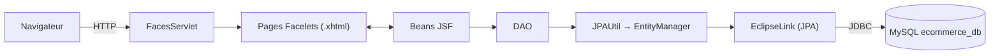
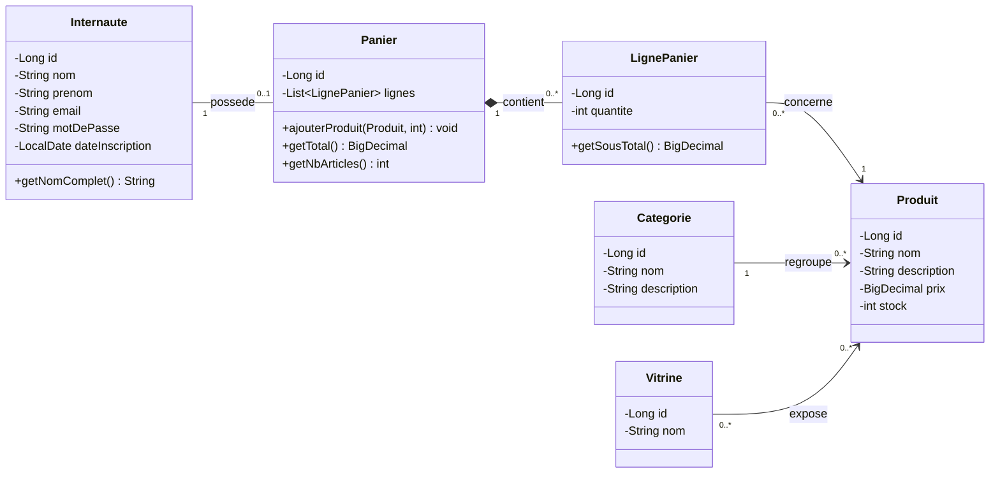
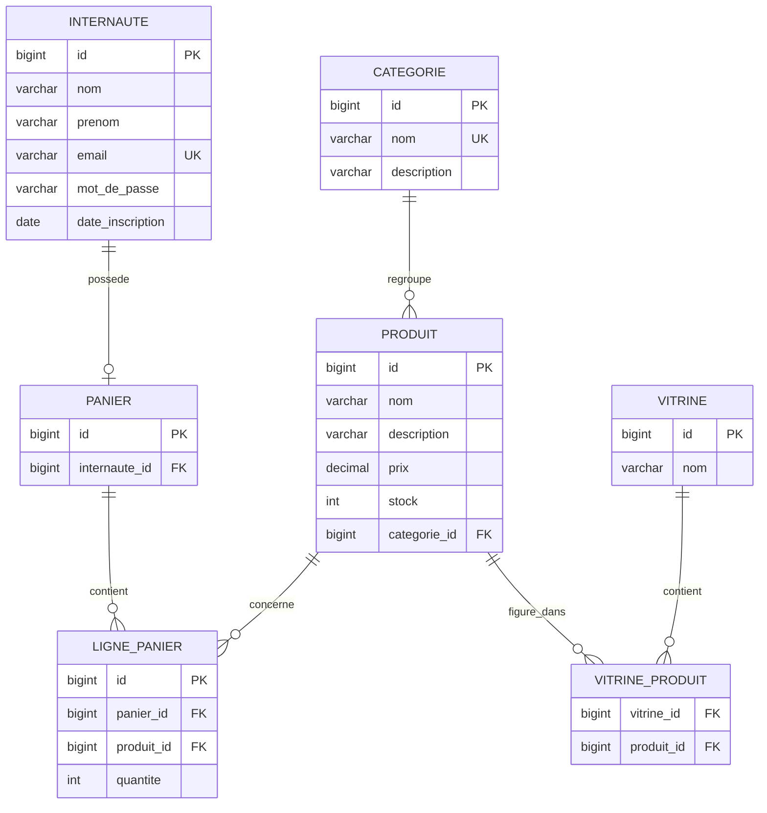
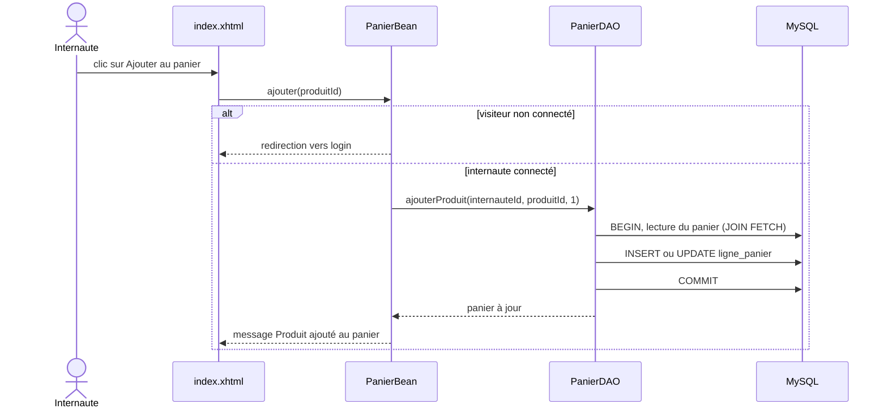

Atelier JEE · JSF + JPA

# MarocShop

Site e-commerce de démonstration : une vitrine de produits, des internautes qui s'inscrivent et un panier enregistré en base MySQL. Cette page décrit toute l'application, de l'architecture à l'installation.

- Java **11+**
- JSF **2.2** (Mojarra 2.2.20)
- JPA **2.2** · EclipseLink 2.7.13
- MySQL **8**
- Tomcat **9**
- Maven **WAR**

Korchi Alaa · Faculté des Sciences et Techniques de Tanger · Module JEE, Pr. Lotfi Elaachak

## Sommaire

- [Vue d'ensemble](#apercu)
- [Technologies](#stack)
- [Architecture](#architecture)
- [Structure du projet](#structure)
- [Modèle de données](#donnees)
- [Persistance JPA](#persistance)
- [Couche JSF](#jsf)
- [Sécurité](#securite)
- [Installation](#installation)
- [Parcours de démo](#demo)
- [Tests](#tests)
- [Dépannage](#depannage)
- [Limites et pistes](#limites)

## Vue d'ensemble

L'application suit l'énoncé de l'atelier : mettre en place un site e-commerce en se concentrant sur la **vitrine**, l'**internaute** et le **panier**. Elle comprend 6 entités JPA, 7 tables MySQL, 5 DAO, 4 beans JSF, 6 fichiers Facelets et 4 tests.

**Vitrine**Grille de produits avec filtre par catégorie et recherche par mot-clé.

**Internaute**Inscription, connexion et déconnexion, mot de passe haché.

**Panier**Ajout, quantités, retrait, vidage et total, avec contrôle du stock.

**Catalogue**Page d'administration pour ajouter ou supprimer des produits.

| Fonction | Page | Bean | DAO |
| --- | --- | --- | --- |
| Parcourir et filtrer la vitrine | `index.xhtml` | `VitrineBean` | `VitrineDAO`, `CategorieDAO` |
| S'inscrire | `inscription.xhtml` | `InternauteBean` | `InternauteDAO` |
| Se connecter, se déconnecter | `login.xhtml` | `InternauteBean` | `InternauteDAO` |
| Ajouter au panier | `index.xhtml` | `PanierBean` | `PanierDAO` |
| Quantités, retrait, vidage, total | `panier.xhtml` | `PanierBean` | `PanierDAO` |
| Ajouter ou supprimer un produit | `produits.xhtml` | `ProduitBean` | `ProduitDAO` |

Au premier démarrage, une base vide reçoit un jeu de démonstration : 3 catégories (Informatique, Téléphonie, Maison), 9 produits et une « Vitrine principale ». Les prix sont en dirhams (MAD).

## Technologies et compatibilité

| Composant | Version | Rôle |
| --- | --- | --- |
| JDK | 11 ou 17 conseillé | Le projet est compilé avec `release 11`. |
| Maven | 3.9 | Packaging `war`, gestion des dépendances. |
| Tomcat | **9.0.x** | Conteneur web. Il fournit l'API Servlet, pas JPA ni JTA. |
| Mojarra (`jsf-api`, `jsf-impl`) | 2.2.20 | Implémentation de JSF 2.2 : Facelets et beans managés. |
| EclipseLink | 2.7.13 | Implémentation de JPA 2.2 (apporte aussi l'API `javax.persistence`). |
| MySQL Connector/J | 8.0.33 | Pilote JDBC. |
| `javax.servlet-api` | 4.0.1, *provided* | Fournie par Tomcat, absente du WAR. |
| `javax.annotation-api` | 1.3.2, *provided* | `@PostConstruct`, retiré du JDK depuis Java 11. |
| JUnit + H2 | 4.13.2 + 1.4.200 | Tests de persistance en mémoire, sans MySQL. |

### Pourquoi Tomcat 9 et pas Tomcat 10

Les versions imposées par l'énoncé (JSF 2.2.20, Servlet 4.0) appartiennent à l'ère `javax.*`. Tomcat 10 est passé à `jakarta.*` et ne peut pas les charger.

|  | Tomcat 9 (ce projet) | Tomcat 10.1 |
| --- | --- | --- |
| Paquets | `javax.servlet`, `javax.persistence` | `jakarta.servlet`, `jakarta.persistence` |
| Servlet | 4.0 | 6.0 |
| Faces | JSF 2.2 (Mojarra 2.2.20) | Jakarta Faces 4.0 |
| Persistance | EclipseLink 2.7.x | EclipseLink 4.x |
| Verdict | Fonctionne avec le projet | Erreur `ClassNotFoundException: javax.servlet…` |

À retenir

Lancez l'application sur **Tomcat 9.0.x**. Le dossier `apache-tomcat-10.x` ne convient pas, même avec un autre JDK.

### Écarts avec le pom.xml de l'énoncé

- `javax.persistence 2.0.0` est retiré : EclipseLink 2.7 contient déjà l'API JPA 2.2, les deux versions entreraient en conflit.
- `javax.servlet-api` passe en scope `provided`, car Tomcat la fournit.
- Les balises inversées (`>dependency<`) de l'énoncé sont remises en forme.

## Architecture

Une requête traverse cinq couches. Chacune ne parle qu'à la suivante, ce qui rend le code facile à tester et à faire évoluer.

Figure 1. Chemin d'une requête, du navigateur à MySQL.

| Couche | Paquet | Responsabilité |
| --- | --- | --- |
| Présentation | `webapp/*.xhtml` | Pages Facelets, un gabarit commun, validations de formulaires. |
| Contrôle | `bean` | Beans JSF : état de la page ou de la session, messages à l'utilisateur. |
| Accès aux données | `dao` | Requêtes JPQL et transactions. Un DAO par entité. |
| Modèle | `model` | Entités JPA et logique métier du panier. |
| Infrastructure | `util`, `listener` | `EntityManagerFactory` unique, hachage, données de démo, démarrage et arrêt. |

### Les règles de conception

- **Un `EntityManager` par opération**, fermé dans un `finally`. Les entités renvoyées sont donc *détachées*.
- **Chargements explicites** : le panier est lu avec `JOIN FETCH`, car un chargement paresseux échouerait une fois l'`EntityManager` fermé.
- **Transactions locales** (`RESOURCE_LOCAL`) : Tomcat n'a ni JTA ni injection de `@PersistenceContext`.
- **Les beans ne touchent jamais JPA** : ils appellent uniquement des DAO.

## Structure du projet

Cliquez sur un fichier pour voir son rôle.

## Modèle de données

Le diagramme de classes de l'étape 1 donne six entités. EclipseLink en déduit sept tables, la relation plusieurs-à-plusieurs entre vitrine et produit passant par une table de jointure.

Figure 2. Les classes Java (paquet `ma.fstt.ecommerce.model`).

Figure 3. Les tables créées dans `ecommerce_db`.

### Du diagramme à JPA

| Relation | Annotations | Effet en base |
| --- | --- | --- |
| Categorie 1 — * Produit | `@ManyToOne` / `@OneToMany(mappedBy)` | Clé étrangère `produit.categorie_id` |
| Vitrine * — * Produit | `@ManyToMany` + `@JoinTable` | Table `vitrine_produit` |
| Internaute 1 — 1 Panier | `@OneToOne` + `@JoinColumn(unique)` | `panier.internaute_id` unique |
| Panier 1 — * LignePanier | `@OneToMany(cascade = ALL, orphanRemoval)` | Les lignes vivent et meurent avec le panier |
| LignePanier * — 1 Produit | `@ManyToOne` | `ligne_panier.produit_id` |

Les clés primaires utilisent `@GeneratedValue(strategy = IDENTITY)`, soit l'auto-incrément MySQL. Les prix sont des `BigDecimal` en `DECIMAL(10,2)`, jamais des `double`.

### La logique métier du panier

Elle vit dans l'entité elle-même : fusion des lignes d'un même produit et refus de dépasser le stock.

## Persistance JPA

### persistence.xml

L'unité `ecommercePU` déclare les six entités, la connexion MySQL et la génération automatique des tables.

| Propriété | Effet |
| --- | --- |
| `transaction-type="RESOURCE_LOCAL"` | Transactions gérées dans le code (`em.getTransaction()`), faute de JTA sous Tomcat. |
| `createDatabaseIfNotExist=true` | Crée `ecommerce_db` si elle n'existe pas (droit `CREATE` requis). |
| `eclipselink.ddl-generation` | `create-or-extend-tables` crée les tables manquantes et ajoute les colonnes nouvelles, sans rien supprimer. |
| `eclipselink.logging.level=FINE` | Affiche le SQL dans la console Tomcat, utile pour le rapport. |
| `serverTimezone=UTC` | Évite l'erreur de fuseau horaire de MySQL Connector/J 8. |

À adapter

Utilisateur et mot de passe MySQL se règlent dans ce fichier. Par défaut : `root` avec un mot de passe vide.

### Le schéma transactionnel

`AbstractDAO` factorise le cycle ouverture, travail, validation et fermeture. Chaque DAO l'utilise sans répéter le code.

### Les DAO

| Classe | Méthode | Rôle |
| --- | --- | --- |
| `AbstractDAO` | `enregistrer`, `trouver`, `trouverTous`, `supprimer` | `persist` si l'id est nul, `merge` sinon. |
| `CategorieDAO` | `trouverTous` | Catégories triées par nom. |
| `InternauteDAO` | `trouverParEmail`, `existeEmail` | Connexion et unicité de l'email. |
| `VitrineDAO` | `trouverPrincipale`, `produitsDeLaVitrine` | Requête JPQL construite selon les filtres catégorie et mot-clé. |
| `ProduitDAO` | `creer`, `supprimer` | Création et mise en vitrine en une transaction. La suppression retire d'abord le produit des vitrines. |
| `PanierDAO` | `trouverParInternaute`, `ajouterProduit`, `modifierQuantite`, `retirerLigne`, `vider` | Panier chargé avec `JOIN FETCH`, créé à la première utilisation. |

### Démarrage de l'application

`AppListener` (un `ServletContextListener`) crée l'`EntityManagerFactory` au démarrage, ce qui génère les tables. `DataInitializer` insère ensuite les données de démonstration si aucune vitrine n'existe. À l'arrêt, la fabrique est fermée proprement. Si MySQL est injoignable, l'application refuse de démarrer et l'erreur s'affiche dans la console.

## Couche JSF

### Les beans

| Bean | Portée | Ce qu'il gère |
| --- | --- | --- |
| `VitrineBean` | `@ViewScoped` | Vitrine, catégories, produits affichés, filtres. Recharge la liste à chaque *Filtrer*. |
| `InternauteBean` | `@SessionScoped` | Inscription (mots de passe identiques, email unique), connexion, déconnexion. Garde l'internaute connecté. |
| `PanierBean` | `@SessionScoped` | Actions du panier. Reçoit `InternauteBean` par `@ManagedProperty`. Redirige un visiteur anonyme vers `login`. |
| `ProduitBean` | `@ViewScoped` | Formulaire d'ajout de produit et liste de suppression. |

Les portées *vue* conservent l'état tant que l'utilisateur reste sur la même page. Les portées *session* le conservent pendant toute la visite, ce qui convient à l'internaute connecté et à son panier.

### Exemple : ajouter un produit au panier

Figure 4. Déroulement de `PanierBean.ajouter`.

Une erreur métier, par exemple un stock insuffisant, devient un `FacesMessage` affiché en haut de page. Le bean recharge alors le panier depuis la base pour rester cohérent avec elle.

### Les pages Facelets

| Page | Contenu |
| --- | --- |
| `template.xhtml` | Gabarit : barre de navigation avec compteur du panier, état de connexion, zone de messages, pied de page. |
| `index.xhtml` | Vitrine : filtres, grille de produits, bouton *Ajouter au panier* désactivé en rupture de stock. |
| `login.xhtml` | Formulaire de connexion. |
| `inscription.xhtml` | Inscription avec champs obligatoires, format d'email et mot de passe d'au moins 6 caractères. |
| `panier.xhtml` | Tableau des lignes, quantités modifiables, total, vidage. |
| `produits.xhtml` | Administration du catalogue. |

Dans `web.xml`, la `FacesServlet` est mappée sur `*.xhtml` et `index.xhtml` est la page d'accueil. Le paramètre `INTERPRET_EMPTY_STRING_SUBMITTED_VALUES_AS_NULL` transforme un champ vide en `null`, ce qui évite qu'un `Long` devienne `0` dans les listes déroulantes.

## Sécurité

- Les mots de passe ne sont jamais stockés en clair : SHA-256 avec un sel aléatoire de 16 octets, enregistré sous la forme `sel$hash` en Base64. La comparaison se fait en temps constant.
- Les emails sont normalisés (minuscules, espaces retirés) avant la recherche et l'enregistrement.
- La déconnexion invalide la session entière, panier chargé en mémoire compris.
- Les requêtes JPQL utilisent des paramètres nommés, ce qui écarte l'injection SQL.

Limite assumée

`produits.xhtml` n'a aucun contrôle d'accès : tout visiteur peut ajouter ou supprimer des produits. C'est une simplification d'atelier, à ne pas reproduire en production.

## Installation et lancement

### Prérequis

- JDK 17 (ou 11), installé et déclaré dans IntelliJ.
- Tomcat **9.0.x**, archive « Core » décompressée.
- MySQL 8 ou MariaDB sur le port 3306.

Pas de MySQL sous la main ? Une ligne avec Docker suffit :

### Lancer l'application

1. File › Open…, choisir le fichier `pom.xml`, puis *Open as Project*. Maven importe les dépendances.
2. File › Project Structure : choisir le JDK 17 comme *Project SDK*.
3. Run › Edit Configurations › + › *Tomcat Server* › *Local*.
4. *Application server* : *Configure…* puis le dossier de Tomcat 9. *JRE* : le JDK 17.
5. Onglet *Deployment* : + › *Artifact* › `ecommerce-jsf-jpa:war exploded`. Mettre *Application context* à `/ecommerce`.
6. Démarrer MySQL, puis lancer la configuration.

1. Ouvrir le projet via `pom.xml` comme ci-contre.
2. Settings › Plugins : installer **Smart Tomcat**.
3. Run › Edit Configurations › + › *Smart Tomcat*.
4. *Tomcat Server* : le dossier de Tomcat 9. *Deployment Directory* : `src/main/webapp`. *Context Path* : `/ecommerce`.
5. Choisir le JDK 17 comme JRE, puis lancer.

Le contexte est alors le nom du WAR : `/ecommerce`.

Une fois Tomcat démarré, ouvrez [http://localhost:8080/ecommerce/](http://localhost:8080/ecommerce/). Au premier lancement, la console affiche les `CREATE TABLE` générés par EclipseLink.

## Parcours de démonstration

1. Sur la vitrine, choisir la catégorie *Informatique* puis *Filtrer* : 4 produits restent. Taper « souris » : 1 produit.
2. Cliquer sur *Ajouter au panier* sans être connecté : vous arrivez sur la page de connexion.
3. Créer un compte via *Inscription*. Vous êtes connecté et ramené à la vitrine.
4. Ajouter une souris deux fois et un clavier : le compteur de la barre affiche *Panier (3)*.
5. Ouvrir le panier : le total est de 707,00 MAD (2 × 129 + 449).
6. Saisir une quantité de 9999 et valider : un message signale le stock insuffisant et rien n'est modifié.
7. Ouvrir *Catalogue (admin)*, ajouter un produit : il apparaît aussitôt dans la vitrine.

## Tests

`PersistanceTest` (JUnit 4) fonctionne sur une base H2 en mémoire : aucun MySQL n'est nécessaire. `JPAUtil.initialiser(...)` remplace les propriétés de `persistence.xml` par celles de H2.

| Test | Vérifie |
| --- | --- |
| `donneesDeDemonstrationEtVitrine` | 9 produits, 3 catégories, filtres par catégorie et par mot-clé. |
| `inscriptionEtMotDePasseHache` | Hachage, vérification, unicité de l'email. |
| `cycleDeVieDuPanier` | Ajout, fusion, total, quantité, dépassement de stock avec retour en arrière, retrait, vidage. |
| `creationEtSuppressionDeProduit` | Création avec mise en vitrine, puis suppression propre. |

Statut

Ces tests sont écrits mais n'ont pas encore été exécutés : l'environnement de rédaction n'avait pas accès à Maven Central. Lancez `mvn test` une première fois chez vous, c'est le moyen le plus rapide de valider votre installation de Maven et du JDK.

## Dépannage

`ClassNotFoundException: javax.servlet.ServletRequestListener`

**Cause.** L'application tourne sur Tomcat 10, qui utilise `jakarta.servlet`. Le journal indique *Apache Tomcat/10.1.x*.

**Solution.** Pointer la configuration IntelliJ vers un Tomcat **9.0.x** (voir [Installation](#installation)).

`Communications link failure` ou `Connection refused`

MySQL n'est pas démarré, ou n'écoute pas sur le port 3306. Démarrez-le, ou changez le port dans l'URL de `persistence.xml`. L'application ne démarre pas tant que la connexion échoue : la cause exacte est dans la console Tomcat.

`Access denied for user 'root'@'localhost'`

Le mot de passe de `persistence.xml` ne correspond pas à celui de MySQL. Corrigez `javax.persistence.jdbc.password`.

`CREATE command denied` ou `Unknown database 'ecommerce_db'`

L'utilisateur n'a pas le droit de créer la base. Créez-la vous-même, puis relancez :

Erreur 404 au lancement

Le contexte de déploiement n'est pas `/ecommerce`. Vérifiez *Application context* dans l'onglet *Deployment* (par défaut IntelliJ propose `/ecommerce_jsf_jpa_war_exploded`), ou utilisez l'URL correspondante.

Page blanche, ou texte `#{…}` visible

La page n'est pas passée par la `FacesServlet`. Utilisez toujours une URL en `.xhtml` et vérifiez que `jsf-impl` est présent dans `WEB-INF/lib` (*Project Structure* › *Artifacts*). Après un changement de dépendance, rechargez Maven.

`UnsupportedClassVersionError` ou erreurs `InaccessibleObjectException`

Le JDK utilisé par Tomcat ne correspond pas : trop ancien (le code exige Java 11), ou trop récent pour des bibliothèques de 2018 à 2019 comme JSF 2.2 et EclipseLink 2.7. Réglez le champ *JRE* de la configuration Tomcat sur un JDK 17.

Port 8080 déjà utilisé

Repérez le processus qui occupe le port, puis arrêtez-le, ou changez le port HTTP dans la configuration Tomcat.

Accents mal affichés

L'URL JDBC impose déjà `characterEncoding=UTF-8`. Vérifiez que la base est en `utf8mb4` et que vos fichiers sont enregistrés en UTF-8.

Mes modifications n'apparaissent pas

Dans IntelliJ, utilisez *Update classes and resources* (ou relancez le serveur) après chaque changement de code Java. Les fichiers `.xhtml` sont pris en compte à chaud en mode `Development`.

## Limites et pistes d'amélioration

| Sujet | État actuel | Piste |
| --- | --- | --- |
| Commande | Pas de validation de commande, le stock n'est pas décrémenté. | Entité `Commande` et décrémentation transactionnelle. |
| Accès | Catalogue ouvert à tous. | Rôle administrateur et filtre de sécurité. |
| Mots de passe | SHA-256 salé. | bcrypt ou Argon2, algorithmes volontairement lents. |
| Connexions | Une connexion JDBC par `EntityManager`, configurée dans `persistence.xml`. | Pool de connexions et `DataSource` JNDI de Tomcat. |
| Schéma | Généré par EclipseLink à chaque démarrage. | Migrations versionnées avec Flyway. |
| Concurrence | Pas de verrou : deux achats simultanés peuvent dépasser le stock. | `@Version` (verrou optimiste). |
| Beans | `@ManagedBean`, déprécié depuis JSF 2.3. | CDI : `@Named` et `@ViewScoped` de `javax.faces.view`. |

MarocShop 1.0.0 · Atelier JEE, FSTT Tanger · Références : « Put JPA in your web app » (blogs.sap.com, 2012) et la documentation ObjectDB sur le stockage d'entités JPA.